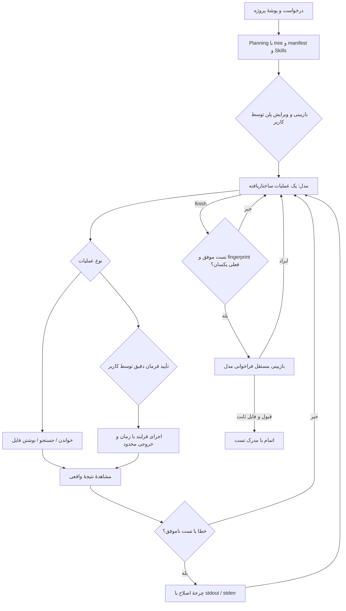

# معماری Milo Code

## تصمیم اصلی

از سه مسیر چالش، **Coding Harness** انتخاب شده است. برنامه یک Electron Desktop App است: main process به فایل و فرایند و مدل دسترسی دارد؛ renderer فقط دادهٔ لازم را از یک preload محدود دریافت می‌کند. برای انتشار، NSIS فایل نصب مستقل Windows x64 می‌سازد. UI به سرور محلی یا Python وابسته نیست.

مدل، موتور پیشنهاد پلن و عملیات است. مالک حلقهٔ اجرا، مدیریت state، I/O، زمان، approval و معیار موفقیت خود برنامه است. از فریم‌ورک آمادهٔ ایجنت استفاده نشده است. وابستگی runtime جاوااسکریپتی خارج از Electron وجود ندارد.



## اجزا و قراردادها

| جزء                  | مسئولیت                                                                      |
| -------------------- | ---------------------------------------------------------------------------- |
| `src/main.cjs`       | چرخهٔ پنجره، native dialog، IPC، انتخاب پروژه و مدل، تنظیمات                 |
| `src/preload.cjs`    | API صریح رابط؛ بدون دسترسی عمومی Node یا generic IPC                         |
| `core/harness.cjs`   | state machine مستقل، بودجهٔ اجرا و اصلاح، approval و completion gate         |
| `core/provider.cjs`  | Chat Completions، schema JSON، یک فرصت اصلاح فرمت، timeout/abort             |
| `core/workspace.cjs` | containment، private-path filtering، UTF-8 I/O، hash conflict و fingerprint  |
| `core/commands.cjs`  | resolve ابزار، spawn بدون shell، محیط محدود، خروجی و زمان محدود، توقف فرایند |
| `core/skills.cjs`    | بارگذاری declarative skills، hash و اعتماد، ابزارهای runtime                 |
| `core/settings.cjs`  | رمزنگاری کلید با safeStorage، تنظیمات و مهارت‌های افزوده                     |
| `core/store.cjs`     | snapshot اتمیک در صف، تاریخچه و پاک‌سازی کلیدهای قابل‌شناسایی                |
| `core/demo.cjs`      | مدل اسکریپتی صریح دمو، با همان ابزار و تست واقعی                             |
| `renderer/`          | رابط فارسی، پلن قابل ویرایش، source editor، قبل/بعد، event log و output      |

قرارداد پلن شامل `title`, `summary`, `steps[2..8]`, `acceptance[1..6]` و فرمان `verification` است. قرارداد عملیات یا یک `tool` با `step`, `args`, `message` است یا `finish` با خلاصه. متن توضیح کوتاه فعالیت برای کاربر است، نه زنجیرهٔ فکر خصوصی مدل.

ابزارهای فایل: `list_files`, `read_file`, `search_files`, `write_file`. ابزارهای اجرا: `run_command`, `run_skill`, `verify`. `write_file` به hash خوانده‌شدهٔ فایل یا `null` برای فایل تازه نیاز دارد. `verify` هیچ آرگومان فرمانی از مدل نمی‌پذیرد؛ فقط فرمانی را اجرا می‌کند که انسان در پلن تأیید کرده است. نتیجهٔ `run_command` یا ابزار مهارت به‌تنهایی جای `verify` را نمی‌گیرد.

## State و دوام

State شامل شناسه، درخواست، root، mode، plan، status، currentStep، iterations، corrections، observations، changes، backups، verification، review، summary و events است. وضعیت‌ها:

```text
planning → awaiting_plan → running ⇄ awaiting_approval
                             ↓           ↓
                         correcting ← verifying
                             ↓
                         reviewing → completed
                                  ↘ needs_attention
هر وضعیت فعال → stopped
```

هر عملیات یک snapshot نسخه‌دار محلی با timestamp تولید می‌کند؛ ذخیره‌ها در صف و با rename اتمیک انجام می‌شوند. ۱۴ مشاهدهٔ اخیر و ۱۶۰ رویداد اخیر نگه‌داری می‌شوند. محتوا و hash نسخهٔ قبل از اولین ویرایش مدل پیش از نوشتن در snapshot ثبت می‌شود. گزارش JSON شامل قبل/بعد و خروجی تست است؛ بنابراین گزارش را مثل سورس پروژه خصوصی یا عمومی کن. بازکردن تاریخچه اجرای فرمان را از سر نمی‌گیرد و approval قدیمی قابل استفاده نیست.

## اعتبار موفقیت و بازیابی

- حد پیش‌فرض ۲۸ عملیات و ۶ چرخهٔ خطا/اصلاح است. رسیدن به حد یا خطای مدل، `needs_attention` می‌سازد.
- هر subprocess تأیید یک‌باره با nonce و runId می‌گیرد. رد درخواست نتیجه‌ای به مدل برمی‌گرداند؛ فرمان اجرا نمی‌شود.
- stdout/stderr واقعی با exit code، timeout، زمان اجرا و truncation ثبت می‌شود.
- `verify` باید exit code صفر داشته باشد و fingerprint قبل/بعد تست یکسان بماند.
- `finish` فقط با verification معتبر روی فایل‌های فعلی وارد بازبینی می‌شود. پس از بازبینی هم fingerprint دوباره بررسی می‌شود.
- ویرایش دستی یا اجرای فرمان دیگر، verification قبلی را باطل می‌کند. تغییر خارجی با hash/fingerprint شناسایی می‌شود.
- stop، درخواست مدل را abort می‌کند؛ برای child متعلق به همین اجرا در ویندوز taskkill با PID دقیق و fallback مستقیم به‌کار می‌رود.
- تغییرات به‌صورت خودکار rollback یا commit نمی‌شوند. کاربر نسخهٔ قبل/بعد را می‌بیند و می‌تواند دستی اصلاح کند.

## مرز اعتماد

`contextIsolation:true`, `nodeIntegration:false`, `sandbox:true`؛ CSP فقط فایل‌های محلی برنامه را می‌پذیرد. خروجی مدل، source و log با textContent/textarea نمایش داده می‌شوند. پنجرهٔ تازه، navigation خارجی و permissionهای مرورگر رد می‌شوند. IPC فقط از renderer اصلی با frame URL دقیق پذیرفته می‌شود. متن پروژه و مهارت برای مدل untrusted task data است.

Skill کد JS دلخواه load نمی‌کند؛ manifest و راهنماست. واردکردن مهارت پیش‌نمایش و تأیید انسان دارد؛ تغییر hash اعتماد را باطل می‌کند. حتی مهارت trusted، تأیید فرمان را حذف نمی‌کند.

ابزار فایل sandbox مسیر برنامه است؛ **subprocess، sandbox سیستم‌عامل ندارد**. تأیید انسانی مسئول انتخاب فرمان/پروژهٔ قابل اجراست. allowlist محیط، کلید سرویس را به فرزند منتقل نمی‌کند. API key رمزنگاری‌شده فقط در main باز می‌شود؛ renderer صرفاً `hasKey` می‌بیند. تغییر host کلید قدیمی را پاک می‌کند. فیلتر اسرار کمک دفاعی است و تضمین کشف همهٔ اطلاعات حساس نیست.

## مصالحه‌ها و محدوده

Electron نصب‌کنندهٔ بزرگ‌تری دارد ولی runtime Node را همراه می‌آورد و تست دمو بدون نصب Node روی سیستم اجرا می‌شود. ویرایشگر textarea است و LSP/debugger ندارد. اجرای هم‌زمان چند پروژه و resume خودکار وجود ندارد. اتمام به کیفیت تست تأییدشده و بازبینی مدل هم وابسته است؛ exit صفر تضمین نبود همهٔ خطاهای نرم‌افزار نیست. ابزارهای فایل روی پروژه‌های کوچک و متوسط و فایل‌های UTF-8 تا ۲۰۰KB طراحی شده‌اند؛ tree و context محدودند. کدهای باینری/خروجی build و dependencyها وارد context نمی‌شوند.

## منابع رسمی

- [Electron context isolation](https://www.electronjs.org/docs/latest/tutorial/context-isolation)
- [Electron process sandbox](https://www.electronjs.org/docs/latest/tutorial/sandbox)
- [electron-builder 26 NSIS](https://www.electron.build/v26/docs/nsis/)
- [AvalAI API introduction](https://docs.avalai.org/en/api-reference/introduction)
