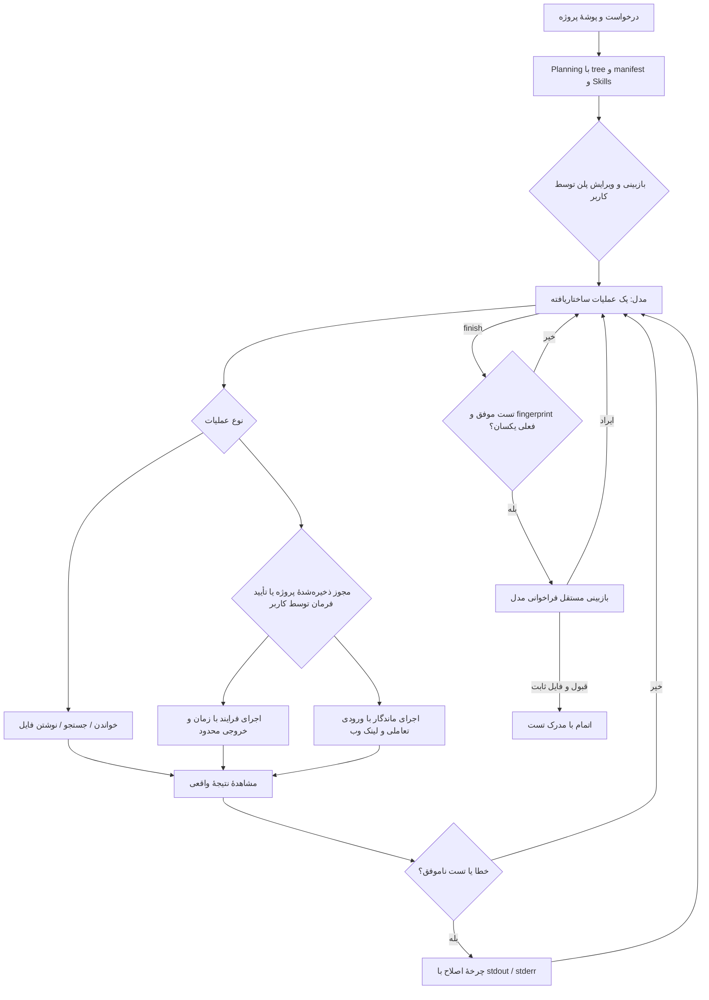

# معماری Milo Code

## تصمیم اصلی

از سه مسیر چالش، **Coding Harness** انتخاب شده است. برنامه یک Electron Desktop App است: main process به فایل و فرایند و مدل دسترسی دارد؛ renderer فقط دادهٔ لازم را از یک preload محدود دریافت می‌کند. برای انتشار، NSIS فایل نصب مستقل Windows x64 می‌سازد. UI به سرور محلی یا Python وابسته نیست.

مدل، موتور پیشنهاد پلن و عملیات است. مالک حلقهٔ اجرا، مدیریت state، I/O، زمان، approval و معیار موفقیت خود برنامه است. از فریم‌ورک آمادهٔ ایجنت استفاده نشده است. وابستگی runtime جاوااسکریپتی خارج از Electron وجود ندارد.



## اجزا و قراردادها

| جزء                           | مسئولیت                                                                                    |
| ----------------------------- | ------------------------------------------------------------------------------------------ |
| `src/main.cjs`                | چرخهٔ پنجره، native dialog، IPC، انتخاب پروژه و مدل، تنظیمات                               |
| `src/preload.cjs`             | API صریح رابط؛ بدون دسترسی عمومی Node یا generic IPC                                       |
| `core/harness.cjs`            | state machine مستقل، بودجهٔ اجرا و اصلاح، approval و completion gate                       |
| `core/provider.cjs`           | Chat Completions، schema JSON، یک فرصت اصلاح فرمت، timeout/abort                           |
| `core/catalog.cjs`            | preset سرویس‌ها، GET models با کلید همان سرویس، محدودیت پاسخ و نرمال‌سازی شناسه            |
| `core/projects.cjs`           | ساخت پوشهٔ خالی مستقل و تهیهٔ خلاصهٔ زمینهٔ درخواست قبلی                                   |
| `core/workspace.cjs`          | containment، private-path filtering، UTF-8 I/O، hash conflict و fingerprint                |
| `core/commands.cjs`           | resolve ابزار، spawn بدون shell، محیط محدود، خروجی و زمان محدود، توقف فرایند               |
| `core/runtime.cjs`            | برنامهٔ ماندگار، stdin، بررسی HTTP و پورت، پیش‌نمایش HTML و توقف فرایندهای متعلق به برنامه |
| `core/skills.cjs`             | بارگذاری declarative skills، hash و اعتماد، ابزارهای runtime                               |
| `core/settings.cjs`           | کلید رمز‌شدهٔ مستقل، مهاجرت v1، فهرست مدل‌ها و پیش‌فرض عمومی/پروژه                         |
| `core/store.cjs`              | snapshot اتمیک در صف، تاریخچه و پاک‌سازی کلیدهای قابل‌شناسایی                              |
| `core/demo.cjs`               | مدل اسکریپتی صریح دمو، با همان ابزار و تست واقعی                                           |
| `renderer/`                   | رابط فارسی، پلن قابل ویرایش، source editor، قبل/بعد، event log و output                    |
| `renderer/model-controls.mjs` | پنل پرووایدرها، جستجوی مدل‌ها و انتخاب برای درخواست فعلی                                   |
| `renderer/project-tools.mjs`  | مجوز پروژه، بازکردن پوشه و فایل، لینک مرورگر، ورودی و خروجی اجرای برنامه                   |

قرارداد پلن شامل `title`, `summary`, `steps[2..8]`, `acceptance[1..6]` و فرمان `verification` است. قرارداد عملیات یا یک `tool` با `step`, `args`, `message` است یا `finish` با خلاصه. متن توضیح کوتاه فعالیت برای کاربر است، نه زنجیرهٔ فکر خصوصی مدل.

ابزارهای فایل: `list_files`, `read_file`, `search_files`, `write_file`. ابزارهای اجرا: `run_command`, `run_skill`, `verify`. `write_file` به hash خوانده‌شدهٔ فایل یا `null` برای فایل تازه نیاز دارد. `verify` هیچ آرگومان فرمانی از مدل نمی‌پذیرد؛ فقط فرمانی را اجرا می‌کند که انسان در پلن تأیید کرده است. نتیجهٔ `run_command` یا ابزار مهارت به‌تنهایی جای `verify` را نمی‌گیرد.

ابزار `launch_app` فرایند تعاملی را مستقل از فرمان‌های کوتاه نگه می‌دارد؛ `preview_file` یک فایل HTML و منابع مجازش را با سرور اختصاصی 127.0.0.1 روی پورت آزاد نشان می‌دهد؛ `app_status` وضعیت و نتیجهٔ HTTP واقعی را برمی‌گرداند. `launch_app.command` برنامه، آرگومان‌ها و cwd نسبی دارد و مهلت تست روی آن اعمال نمی‌شود. اجرای برنامه پس از اتمام ایجنت ادامه دارد؛ `verify` همچنان برای اتمام لازم است.

## State و دوام

State شامل شناسه، درخواست، root، mode، connection، continuation، plan، status، currentStep، iterations، corrections، observations، changes، backups، verification، review، summary و events است. `connection` فقط شناسه و نام پرووایدر و مدل را نگه می‌دارد؛ کلید در state قرار نمی‌گیرد. `continuation` خلاصهٔ درخواست و نتیجهٔ قبلی همان پروژه است. وضعیت‌ها:

```text
planning → awaiting_plan → running ⇄ awaiting_approval
                             ↓           ↓
                         correcting ← verifying
                             ↓
                         reviewing → completed
                                  ↘ needs_attention
هر وضعیت فعال → stopped
```

هر عملیات یک snapshot نسخه‌دار محلی با timestamp تولید می‌کند؛ ذخیره‌ها در صف و با rename اتمیک انجام می‌شوند. ۱۴ مشاهدهٔ اخیر و ۱۶۰ رویداد اخیر نگه‌داری می‌شوند. محتوا و hash نسخهٔ قبل از اولین ویرایش مدل پیش از نوشتن در snapshot ثبت می‌شود. گزارش JSON شامل قبل/بعد و خروجی تست است؛ بنابراین گزارش را مثل سورس پروژه خصوصی یا عمومی کن. بازکردن تاریخچه اجرای فرمان را از سر نمی‌گیرد و approval قدیمی قابل استفاده نیست.

## مجوز پروژه و اجرای قابل استفاده

`projectPermissions` در تنظیمات با hash مسیر canonical پروژه کلید می‌خورد و از انتخاب مدل مستقل است. پیش‌فرض `autoApproveCommands:false` است. فقط IPC صریح کاربر می‌تواند آن را تغییر دهد؛ ابزار مدل و دادهٔ تاریخچه این دسترسی را ندارند. opt-in هنگام فرمان در انتظار، nonce و runId فعلی را بررسی می‌کند، تصمیم انسانی را ثبت و همان فرمان را آزاد می‌کند. هر فرمان بعدی سیاست همان پروژه را دوباره می‌خواند و تصمیم خودکار با `actor:project-policy` در گزارش ثبت می‌شود. لغو مجوز روی فرمان‌های بعدی اثر دارد؛ برنامهٔ در حال اجرا دکمهٔ توقف مستقل دارد. تأیید پلن مستقل می‌ماند.

`AppRuntime` به ازای هر پروژه یک اجرای فعال را نگه می‌دارد. یک قفل شروع از دوبار اجرا جلوگیری می‌کند؛ CLI لولهٔ stdin با UTF-8، پایان ورودی و خروجی محدود دارد. برای وب‌سرور، URL فقط HTTP روی loopback با پورت صریح پذیرفته می‌شود. پورت اشغال‌شده پیش از spawn رد می‌شود؛ سپس درخواست GET واقعی با مهلت محدود، statusCode و پیش‌نمایش محدود بدنه ثبت می‌شود. لینک فقط پس از پاسخ 2xx/3xx منتشر می‌شود. زمان اجرای برنامه تا توقف کاربر یا بستن پنجره است و از بودجهٔ گام‌های ایجنت مستقل است. PID، ورودی و سرور در حافظه هستند؛ بازکردن تاریخچه یا راه‌اندازی دوبارهٔ Milo فرایندها را احیا نمی‌کند.

پوشه با `shell.openPath` و فایل با `shell.showItemInFolder` باز می‌شود؛ root و مسیر از Workspace معتبر یا گزارش انتخاب‌شده به دست می‌آید. لینک برنامه با کلیک کاربر از طریق `shell.openExternal` و با اعتبارسنجی دوبارهٔ URL و شناسهٔ اجرای زنده باز می‌شود؛ renderer فرمان عمومی shell یا navigation خارجی ندارد. در پیش‌نمایش HTML، مسیرهای خصوصی، symlink و خروج از root و متد نوشتن مسدودند. در خروج، فرایندهای متعلق به runtime بسته می‌شوند.

## تنظیمات چند پرووایدر

schema نسخهٔ ۲ شامل `providers`، `defaultSelection`، `projects`، `projectPermissions` و `skills` است. هر پروفایل endpoint، مدل پیش‌فرض، encryptedKey و cache فهرست مدل خودش را دارد. فایل قدیمی تک‌پرووایدر با حفظ کلید رمز‌شده، مدل و مهارت‌ها مهاجرت می‌کند. API key هر پروفایل فقط برای درخواست به همان پروفایل استفاده می‌شود؛ پروفایل فاقد کلید به کلید سرویس دیگر رجوع نمی‌کند.

انتخاب صریح درخواست بر پیش‌فرض پروژه و سپس پیش‌فرض عمومی اولویت دارد. پیش‌فرض پروژه با hash مسیر canonical ذخیره می‌شود. main هنگام شروع پلن، پیکربندی و هویت مدل را به provider و هارنس می‌دهد؛ تغییر پیش‌فرض بعدی مدل اجرای موجود را عوض نمی‌کند. گزارش و خلاصهٔ تاریخچه هویت همان اجرا را دارند.

دریافت مدل‌ها با GET models در main انجام می‌شود؛ renderer فقط شناسه و metadata مجاز را می‌گیرد. درخواست‌های هم‌زمان یک پروفایل ادغام می‌شوند و token مبتنی بر endpoint و کلید، پاسخ دیررسِ تنظیمات قبلی را رد می‌کند. پاسخ ناموفق cache موفق را پاک نمی‌کند. رابط برای cache خالی یا قدیمی‌تر از شش ساعت دریافت خودکار دارد؛ تلاش دستی و ورود شناسهٔ مدل نیز در دسترس‌اند. [جزئیات سرویس‌ها](PROVIDERS.md).

## اعتبار موفقیت و بازیابی

درخواست می‌تواند ساخت برنامه از پوشهٔ خالی، توسعهٔ قابلیت یا اصلاح کد موجود باشد. `createProject` پوشهٔ تازه و یکتا زیر دادهٔ برنامه می‌سازد و هیچ فایل اولیه یا جواب آماده‌ای در آن قرار نمی‌دهد. اگر در صفحهٔ شروع پروژه‌ای انتخاب نشده باشد، رابط پیش از ساخت پلن، همین مسیر را فراخوانی می‌کند. مدل طبق پلن، تمام فایل‌های لازم را با `write_file` می‌نویسد.

پس از اتمام، درخواست تکمیلی یک اجرای تازه با خلاصهٔ درخواست قبلی و فایل‌های فعلی می‌سازد. تاریخچه فقط گزارش را می‌خواند؛ `continueRun` با اقدام صریح کاربر پوشهٔ همان گزارش و هویت مدلش را انتخاب می‌کند. approval و subprocess قدیمی از سر گرفته نمی‌شوند.

رابط یک گفتگوی مرکزی و نوار سمت راست دارد. فایل‌ها، تغییرات، مهارت‌ها و خروجی فقط در پنل انتخابی باز می‌شوند. در اجرای فعال، ورودی تازه پنهان می‌شود تا فضای پلن و تأیید در دسترس باشد. تشخیص CLI دسکتاپ به‌صورت فقط‌خواندنی، راست‌بودن نوار، فاصلهٔ تیتر و ورودی و نبود اسکرول افقی را بررسی می‌کند.

- حد پیش‌فرض ۲۸ عملیات و ۶ چرخهٔ خطا/اصلاح است. رسیدن به حد یا خطای مدل، `needs_attention` می‌سازد.
- در حالت دستی، هر subprocess تأیید یک‌باره با nonce و runId می‌گیرد؛ در حالت اجرای خودکار، سیاست ذخیره‌شدهٔ همان پروژه پیش از هر فرمان بررسی و ثبت می‌شود. رد درخواست نتیجه‌ای به مدل برمی‌گرداند؛ فرمان اجرا نمی‌شود.
- stdout/stderr واقعی با exit code، timeout، زمان اجرا و truncation ثبت می‌شود.
- `verify` باید exit code صفر داشته باشد و fingerprint قبل/بعد تست یکسان بماند.
- `finish` فقط با verification معتبر روی فایل‌های فعلی وارد بازبینی می‌شود. پس از بازبینی هم fingerprint دوباره بررسی می‌شود.
- ویرایش دستی یا اجرای فرمان دیگر، verification قبلی را باطل می‌کند. تغییر خارجی با hash/fingerprint شناسایی می‌شود.
- stop، درخواست مدل را abort می‌کند؛ برای child متعلق به همین اجرا در ویندوز taskkill با PID دقیق و fallback مستقیم به‌کار می‌رود.
- تغییرات به‌صورت خودکار rollback یا commit نمی‌شوند. کاربر نسخهٔ قبل/بعد را می‌بیند و می‌تواند دستی اصلاح کند.

## مرز اعتماد

در اتصال Chat Completions، `response_format:json_object` درخواست می‌شود و schema همچنان داخل هارنس اعتبارسنجی می‌شود. اگر مسیر با HTTP 400/422 این درخواست را رد کند، فقط پارامتر فرمت حذف و درخواست محدود تکرار می‌شود؛ مدل و کلید عوض نمی‌شوند. خروجی با `finish_reason:length` هیچ‌گاه اجرا نمی‌شود و یک فرصت اصلاح با سقف بیشتر دارد. خطای گذرای اتصال نیز فقط یک بار تکرار می‌شود. [قرارداد JSON در AvalAI](https://docs.avalai.org/en/guides/structured-outputs).

`contextIsolation:true`, `nodeIntegration:false`, `sandbox:true`؛ CSP فقط فایل‌های محلی برنامه را می‌پذیرد. خروجی مدل، source و log با textContent/textarea نمایش داده می‌شوند. پنجرهٔ تازه، navigation خارجی و permissionهای مرورگر رد می‌شوند. IPC فقط از renderer اصلی با frame URL دقیق پذیرفته می‌شود. متن پروژه و مهارت برای مدل untrusted task data است.

Skill کد JS دلخواه load نمی‌کند؛ manifest و راهنماست. واردکردن مهارت پیش‌نمایش و تأیید انسان دارد؛ تغییر hash اعتماد را باطل می‌کند. اعتماد به خود مهارت، سیاست اجرای فرمان را تغییر نمی‌دهد؛ ابزار مهارت هم از مجوز مستقل همان پروژه پیروی می‌کند.

ابزار فایل sandbox مسیر برنامه است؛ **subprocess، sandbox سیستم‌عامل ندارد**. تأیید انسانی مسئول انتخاب فرمان/پروژهٔ قابل اجراست. allowlist محیط، کلید سرویس را به فرزند منتقل نمی‌کند. API key رمزنگاری‌شده فقط در main باز می‌شود؛ renderer صرفاً `hasKey` می‌بیند. تغییر host کلید قدیمی را پاک می‌کند. فیلتر اسرار کمک دفاعی است و تضمین کشف همهٔ اطلاعات حساس نیست.

## مصالحه‌ها و محدوده

Electron نصب‌کنندهٔ بزرگ‌تری دارد ولی runtime Node را همراه می‌آورد و تست دمو بدون نصب Node روی سیستم اجرا می‌شود. ویرایشگر textarea است و LSP/debugger ندارد. حلقهٔ ایجنت در یک زمان روی یک پروژه کار می‌کند؛ برنامهٔ اجراشدهٔ یک پروژه می‌تواند هنگام رفتن به پروژهٔ دیگر باز بماند. resume خودکار فرایندها وجود ندارد. اتمام به کیفیت تست تأییدشده و بازبینی مدل هم وابسته است؛ exit صفر تضمین نبود همهٔ خطاهای نرم‌افزار نیست. ابزارهای فایل روی پروژه‌های کوچک و متوسط و فایل‌های UTF-8 تا ۲۰۰KB طراحی شده‌اند؛ tree و context محدودند. کدهای باینری/خروجی build و dependencyها وارد context نمی‌شوند.

## منابع رسمی

- [Electron context isolation](https://www.electronjs.org/docs/latest/tutorial/context-isolation)
- [Electron process sandbox](https://www.electronjs.org/docs/latest/tutorial/sandbox)
- [electron-builder 26 NSIS](https://www.electron.build/v26/docs/nsis/)
- [AvalAI API introduction](https://docs.avalai.org/en/api-reference/introduction)
