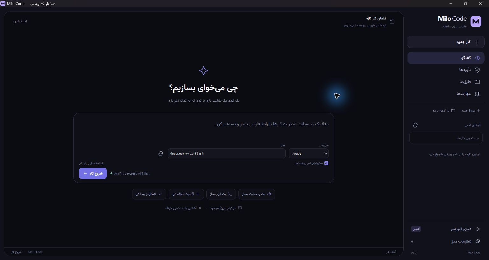

# Milo Code

### میز کار دسکتاپ برای ایجنت کدنویس

پروژهٔ نهایی دورهٔ Agentic AI استارکوچ — **Coding Harness**

Milo Code یک برنامهٔ مستقل و نصب‌شوندهٔ ویندوز برای **ساخت پروژه از صفر، افزودن قابلیت و اصلاح کد موجود** است. ایده‌ات را می‌نویسی، پلن را مرور می‌کنی و مدل با ابزارهای واقعی فایل‌ها را می‌سازد یا ویرایش می‌کند، تست می‌گیرد و خطا را اصلاح می‌کند. اجرای ابزار، تأیید کاربر و اعتبار نتیجه در اختیار هارنس است.



[تصویر گزارش ساخت واقعی برنامه از صفر](docs/desktop-creation.jpg)

## شروع سریع

1. از [Releases](https://github.com/mohsenalipour/starcoach-final-milo-code/releases/latest) فایل **Milo-Code-Setup-1.3.0-x64.exe** را بگیر و نصب کن.
2. **Milo Code** را باز کن. برای استفاده از نسخهٔ نصب‌شده، نصب Node یا Python لازم نیست.
3. در **تنظیمات مدل**، کلید سرویس را ذخیره و مدل را انتخاب کن.
4. در صفحهٔ اصلی بنویس: «یک ابزار خط فرمان تبدیل واحد دما با Node.js بساز؛ تبدیل سلسیوس، فارنهایت و کلوین، تست و راهنمای اجرا داشته باشد.» **شروع کار** را بزن؛ اگر پوشه انتخاب نکرده باشی، پروژه‌ای خالی ساخته می‌شود.
5. پلن و فرمان تست را بررسی و **تأیید پلن و شروع اجرا** را بزن. برای اجازهٔ یک‌بارهٔ هر فرمان **تأیید و اجرا** را انتخاب کن؛ برای ادامهٔ خودکار همان پروژه **تأیید همهٔ فرمان‌های این پروژه** را بزن.
6. در **برنامه و فایل‌های تو**، پوشهٔ واقعی پروژه و فایل‌های ساخته‌شده را باز کن. برای استفاده از برنامه بنویس **«برنامه‌ای که ساختی را اجرا کن تا با آن کار کنم»**. برنامهٔ وب لینک مرورگر می‌گیرد و برنامهٔ خط فرمان، خروجی و ورودی تعاملی دارد.

برای آشنایی بدون کلید و اینترنت، **دموی آموزشی** در نوار راست در دسترس است. این دمو از یک **مدل اسکریپتیِ مشخص و آفلاین** استفاده می‌کند؛ فایل‌ها، اجرای Node و تست‌ها واقعی‌اند. هر بار یک کپی تازه از نمونه می‌سازد. درخواست‌های معمولی با مدل زنده اجرا می‌شوند.

## ساختن و ادامهٔ پروژه

**پروژهٔ جدید** یک پوشهٔ خالی با نام دلخواه در پوشهٔ دادهٔ برنامه می‌سازد. **باز کردن پروژه** برای انتخاب پوشه‌ای در هر محل دلخواه است؛ پوشه می‌تواند خالی باشد یا کد قبلی داشته باشد. مسیر پروژه بالای صفحه دیده می‌شود. اگر بدون انتخاب پوشه **شروع کار** را بزنی، برنامه خودش پروژهٔ تازه می‌سازد.

نمونهٔ درخواست‌ها:

- «یک وب‌سایت مدیریت کارها با رابط فارسی، افزودن و تکمیل و حذف کار و ذخیره در مرورگر بساز؛ راهنمای اجرا و تست هم بنویس.»
- «برای این پروژه امکان خروجی CSV اضافه کن و رفتار فعلی را با تست حفظ کن.»
- «اشکال توابع این پروژه را پیدا کن، با تست نشان بده و اصلاح کن.»

پس از پایان هر اجرا، می‌توانی در همان کادر درخواست تکمیلی بنویسی. خلاصهٔ کار قبلی به مدل داده می‌شود و فایل‌های فعلی دوباره مبنای کارند. در تاریخچهٔ سمت راست، **ادامه روی همین پروژه** پوشهٔ همان گزارش را باز می‌کند و درخواست تازه‌ای آغاز می‌شود؛ فرمان قبلی خودکار تکرار نمی‌شود.

فایل‌ها، تغییرات، مهارت‌ها و خروجی فرمان‌ها در پنلی باز و بسته‌شونده قرار دارند. **تأییدها** درخواست اجازهٔ فعلی را نشان می‌دهد. تاریخچه با نام کار، مسیر پروژه و مدل قابل جستجوست.

## مجوز پروژه، پوشه و اجرای برنامه

گزینهٔ **تأیید همهٔ فرمان‌های این پروژه** یک‌بار برای مسیر واقعی همان پوشه ذخیره می‌شود؛ نصب وابستگی، تست و اجرای برنامهٔ همان پروژه دیگر توقف تأیید جداگانه ندارند. پروژه‌های دیگر پیش‌فرض با تأیید دستی باز می‌شوند. با کلیک روی **اجرای خودکار روشن** در نوار بالا، مجوز را لغو کن؛ فرمان بعدی دوباره اجازه می‌خواهد. پلن همچنان قابل مرور و تأیید است. این مجوز با تغییر مدل یا باز و بسته کردن برنامه از بین نمی‌رود و مدل نمی‌تواند آن را فعال کند.

دکمهٔ پوشه در نوار بالا و **باز کردن پوشه** در کارت خروجی، پروژه را در File Explorer باز می‌کنند. روی نام فایل ساخته‌شده کلیک کن تا محل همان فایل نمایش داده شود. این دسترسی برای گزارش‌های تاریخچه نیز از پوشهٔ همان گزارش استفاده می‌کند.

برای اجرا، درخواست تازه بده یا از فهرست **اجرا یا پیش‌نمایش**، ورودی برنامه را انتخاب و **اجرا** را بزن؛ فرمان دقیق زیر فهرست دیده می‌شود و همین کلیک اجازهٔ اجرای آن است. ورودی‌های رایج Node، Python، اسکریپت‌های start/dev در package.json و HTML شناسایی می‌شوند. برای آرگومان یا پورت دلخواه، درخواست را به ایجنت بگو. ایجنت برای وب‌سرور، لینک محلیِ بررسی‌شده با HTTP می‌دهد؛ HTML مستقل با پیش‌نمایش محلی باز می‌شود. ابزار CLI ورودی متنی و **پایان ورودی** دارد. برنامه بعد از پایان کار ایجنت باز می‌ماند؛ **توقف برنامه** یا بستن Milo آن را می‌بندد. بعد از بازگشایی Milo باید برنامه را دوباره اجرا کنی.

## کار روی پروژهٔ خودت

1. **تنظیمات مدل** را باز کن و تب **AvalAI**، **Metis**، **BoxAPI** یا **سرویس دیگر** را انتخاب کن. کلید هر سرویس جدا ذخیره می‌شود.
2. کلید API همان سرویس را وارد و **ذخیرهٔ تنظیمات** را بزن؛ برنامه فهرست مدل‌ها را از API دریافت می‌کند. نام مدل را جستجو و روی آن کلیک کن. برای نگه‌داشتن مدل پیش‌فرض، دوباره ذخیره کن.
3. **آزمایش اتصال ذخیره‌شده** را بزن، سپس پروژه‌ای تازه بساز یا **باز کردن پروژه** را انتخاب کن. کنار درخواست، پرووایدر و مدل این اجرا را انتخاب کن. با گزینهٔ **پیش‌فرض این پروژه شود**، انتخاب برای درخواست‌های بعدی همان پوشه نگه داشته می‌شود.

برای AvalAI آدرس پیش‌فرض `https://api.avalai.ir/v1` و مدل نمونه `deepseek-v4.1-flash` است. مسیر پیش‌فرض Metis مربوط به مدل‌های OpenAI آن سرویس است؛ برای مسیر سازگار دیگر، آدرس API قابل ویرایش است. اگر سرویس فهرست مدل ارائه نکند، شناسهٔ دقیق مدل را دستی وارد کن. جزئیات در [PROVIDERS.md](PROVIDERS.md) است.

درخواستت را بنویس؛ مثلاً:

> تابع clamp در src/math.cjs برای عدد داخل بازه نتیجهٔ غلط می‌دهد. کد و تست‌ها را بخوان، اشکال را اصلاح کن و تست‌های موجود را بدون تغییر اجرا کن.

مراحل، معیارهای قبولی و فرمان تست در پلن قابل ویرایش‌اند. فرمان‌ها از مجوز انتخاب‌شدهٔ همان پروژه پیروی می‌کنند. کد را نیز می‌توانی در زمان توقف یا انتظار تأیید مستقیماً ویرایش کنی. کلیدهای **Ctrl+Enter** برای شروع کار و **Ctrl+S** برای ذخیرهٔ کد هستند.

## قابلیت‌ها

| نیاز چالش          | پیاده‌سازی                                                                                 |
| ------------------ | ------------------------------------------------------------------------------------------ |
| دسترسی به محیط     | انتخاب پوشه، درخت فایل، خواندن، جستجو، ویرایش با کنترل تداخل نسخه و فرمان واقعی            |
| Planning           | پلن ساختاریافتهٔ قابل ویرایش با مراحل، معیار قبولی و فرمان تست                             |
| Skills             | سه مهارت داخلی و افزودن مهارت از پوشهٔ دارای `skill.json` و `SKILL.md`                     |
| اجرای حلقه‌ای      | یک عملیات در هر گام، بازخورد ابزار، اصلاح خطا و سقف اجرا                                   |
| Validation         | تست واقعی، ثبت exit code و خروجی، کنترل تغییر فایل‌ها پس از تست، بازبینی نهایی مدل         |
| Human in the loop  | تأیید پلن، تأیید فرمان یا مجوز قابل لغو برای همان پروژه، رد/توقف و ویرایش دستی فایل        |
| اجرای قابل استفاده | برنامهٔ ماندگار، لینک مرورگر با بررسی HTTP، پیش‌نمایش HTML، ورودی CLI و دسترسی پوشه        |
| Desktop            | Electron، رابط فارسی، ویرایشگر، مقایسهٔ قبل/بعد، خروجی زنده، تاریخچه و گزارش JSON          |
| مدل و پرووایدر     | کلید مستقل، فهرست واقعی مدل‌ها، انتخاب برای هر درخواست، پیش‌فرض پروژه و ثبت مدل در تاریخچه |
| نصب ویندوز         | NSIS برای Windows x64؛ runtime همراه نصب‌کننده                                             |

فرمان‌های Node با runtime همراه برنامه اجرا می‌شوند. برای فرمان `npm`، Git و Python باید ابزار مربوط روی سیستم نصب باشد. مسیر `.venv` پروژه برای Python در اولویت است. اطلاعات و گزارش‌های اجرا در پوشهٔ دادهٔ برنامه در حساب ویندوز نگه‌داری می‌شوند. تاریخچه پس از بازگشایی فقط خوانده می‌شود و فرمان متوقف‌شده را خودکار اجرا نمی‌کند.

## اجرای سورس

پیش‌نیاز توسعه: Windows x64، Node.js 22.12 یا جدیدتر و اینترنت برای دریافت وابستگی‌های ساخت.

```powershell
npm ci
npm start
```

تنظیمات از داخل برنامه انجام می‌شود. برای توسعه می‌توانی `.env.example` را به `.env` کپی و کلید خودت را وارد کنی؛ این فایل در Git و نصب‌کننده قرار نمی‌گیرد. نسخهٔ نصب‌شده از `.env` استفاده نمی‌کند. کلید با `safeStorage` حساب ویندوز رمز می‌شود؛ در نبود رمزنگاری فقط در حافظه می‌ماند.

```powershell
npm test
npm run test:demo
npm run test:create
npm run test:launch
npm run build:win
```

فایل نصب در `dist/` ساخته می‌شود. جزئیات تست در [TESTING.md](TESTING.md)، راهنمای ارائه در [DEMO.md](DEMO.md)، معماری در [ARCHITECTURE.md](ARCHITECTURE.md) و توسعهٔ مهارت در [SKILLS.md](SKILLS.md) است.

`test:create` یک آزمون زنده و هزینه‌دار است: مدل در پوشه‌ای کاملاً خالی برنامه و تست می‌سازد؛ سپس هفت بررسی مستقل روی نتیجه اجرا می‌شود. در بررسی نسخهٔ 1.2.0، مدل `deepseek-v4.1-flash` چهار فایل را در هفت عملیات ساخت و تست‌ها موفق شدند.

در `test:launch` مدل واقعی همان درخواست «برنامه را اجرا کن» را روی یک پروژهٔ آماده دریافت می‌کند. در نسخهٔ 1.3.0 مدل در پنج عملیات، بدون تغییر فایل‌ها، سرور واقعی راه انداخت؛ پاسخ HTTP و بازماندن برنامه پس از اتمام کار هم بررسی شد. این تست به اینترنت و اعتبار API نیاز دارد.

## مرزهای اجرای ابزار

ابزار فایل فقط داخل پروژهٔ انتخاب‌شده و روی فایل‌های متنی UTF-8 تا ۲۰۰KB کار می‌کند. مسیرهای خصوصی مثل `.env`، کلیدهای SSH، پوشهٔ Git و symlink/junction خوانده نمی‌شوند. فایل دارای کلید قابل تشخیص به مدل به‌صورت پاک‌سازی‌شده داده می‌شود و مدل اجازهٔ بازنویسی آن را ندارد. تشخیص خودکار همهٔ اسرار ممکن نیست؛ پوشه‌ای را انتخاب کن که برای ارسال فایل‌های مرتبطش به سرویس مدل مناسب باشد.

فرمان‌ها با `shell:false` و آرگومان‌های جدا اجرا می‌شوند؛ تست و فرمان کوتاه مهلت محدود دارند، اجرای تعاملی تا توقف کاربر یا بستن Milo باقی می‌ماند. خروجی و تعداد گام‌های ایجنت محدود است. **فرمانِ تأییدشده با دسترسی حساب ویندوز اجرا می‌شود؛ این ابزار sandbox سیستم‌عامل نیست.** دستور npm، تست یا برنامهٔ پروژه می‌تواند کد دلخواه آن پروژه را اجرا کند؛ پنجرهٔ تأیید، executable، آرگومان و مسیر دقیق را نشان می‌دهد. بازنویسی هم‌زمان یک فایل و تغییر فایل‌ها پس از تست اعتبار نتیجه را باطل می‌کند. نسخه‌های قبل و بعد در گزارش محلی ذخیره می‌شوند؛ اجرای Git commit، push یا حذف خودکار در ابزارهای پیش‌فرض وجود ندارد.

هارنس LangGraph، LangChain، SDK ایجنت یا سرویس ایجنت آماده ندارد؛ state machine، پروتکل مدل، رجیستری مهارت، ابزارها، تأیید و validation در همین مخزن پیاده شده‌اند.

MIT · [Vazirmatn font license](assets/fonts/VAZIRMATN-LICENSE)
